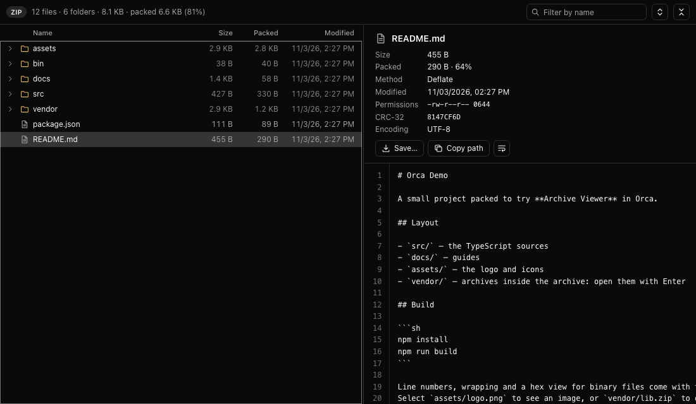

# Archive Viewer for Orca



Browse archives in [Orca](https://orca.dev)'s editor tabs — opened from the file tree, a file
link in an agent chat, or `orca file open`. Without the plugin Orca shows "Binary file — cannot
display" for them.

| Files                                                                                      | What opens                                                   |
| ------------------------------------------------------------------------------------------ | ------------------------------------------------------------ |
| `.zip`, `.jar`, `.war`, `.ear`, `.aar`, `.apk`, `.whl`, `.nupkg`, `.vsix`, `.xpi`, `.ipa`, `.epub` | ZIP: stored, Deflate, bzip2 and Zstandard entries, ZIP64, self-extracting prefixes |
| `.tar`                                                                                     | ustar, GNU and PAX tar: long names, links, modes             |
| `.gz`, `.tgz`, `.bz2`, `.tbz2`, `.tbz`, `.xz`, `.txz`, `.zst`, `.tzst`                     | the tar inside (`.tar.gz` and friends), or the single file   |

Archive Viewer has:

- a **file tree** with size, packed size and date columns, folders first and names in natural
  order; it stays fast with tens of thousands of entries (a big `.jar`);
- a **filter** by name (`⌘F` / `Ctrl+F`), expand and collapse all, and a summary of files,
  folders, sizes and the compression ratio;
- a **preview** of the selected file: text with line numbers and wrapping (the first 2 MB),
  images (PNG, JPEG, GIF, WebP, AVIF, BMP, ICO, SVG), and a hex dump of the first 64 KB for
  anything else; details: size, packed size, method, date, permissions, CRC-32, link target;
- **archives inside archives**: a `.jar` in a `.zip` or a `.tar.gz` in a `.tar` opens in place,
  and a trail at the top leads back; a `.zip.gz` opened from Orca goes straight into the zip;
- **Save…** a single file through Orca's save dialog (up to 64 MB) and **Copy path**;
- **old code pages** for names that the archive stores without UTF-8 (zips made on Windows):
  CP437, CP866 or Windows-1251, picked by Orca's language and switchable in the toolbar;
- the README of the archive selected on opening, like on GitHub;
- Orca's light and dark themes, English and Russian UI.

It is read-only and offline: no capabilities, no network, the file is never modified.

**Not supported.** 7-Zip, RAR, lzip, `.Z` and `.cab` archives show a message saying so.
Encrypted ZIP entries and other ZIP methods (LZMA, PPMd, Deflate64…) are listed but not
unpacked.

**Limits.** Each of these shows a message instead of the archive or the file:

- Orca sends at most 64 MB to a plugin editor and shows its own notice for larger files.
- A compressed stream or an inner archive may unpack to at most 512 MB, and all open levels
  of archives inside archives to 1 GB together, at most 8 levels deep.
- Zstandard: windows up to 128 MB (`zstd --ultra -22` and `--long=27` fit; `--long=28` and
  up do not).
- XZ: dictionaries up to 64 MB (`xz -9` fits), CRC-32, CRC-64 or no check, and the LZMA2
  filter only: no SHA-256 check, no BCJ (`--x86`, `--arm64`…) or delta filters.

A damaged or cut-off archive shows what could be read with a notice: the entries before the
damage, or for a `.gz` of one file, the part of it before the damage (GZIP CRC-32 and size
are checked). A ZIP entry that unpacks to more than the size its archive records is damaged.

## Keyboard

| Key                  | Action                                            |
| -------------------- | ------------------------------------------------- |
| `↑` `↓`              | Previous / next entry (`PageUp` `PageDown` `Home` `End`) |
| `→` `←`              | Open / close a folder, go to its first entry / to the parent |
| `Enter`              | Open or close a folder; open an archive inside    |
| `Esc`                | Clear the filter, back out of an inner archive, clear the selection |
| `Backspace`          | Back out of an inner archive                      |
| `⌘F` / `Ctrl+F`      | Filter by name (`↓` or `Enter` goes to the list)  |

## Install

From the catalog: Orca → Settings → Plugins → ⋯ → **Catalog sources…** → add
`https://github.com/Sergei-Popov/orca-plugin.git`, then install **Archive Viewer**.

From source:

```sh
git clone https://github.com/Sergei-Popov/orca-archive-viewer.git
orca plugin dev load ./orca-archive-viewer   # prints the access it needs and an --approve fingerprint
```

## Develop

No build step: Orca transpiles the TypeScript in `src/` on load.

```sh
orca plugin dev watch . --check   # load, reload on save, stream logs
orca plugin test .                # unit tests (src/**/*.test.ts)
npx -p typescript tsc -p .        # type check, after `orca plugin types .`
orca plugin validate .
orca plugin shot local.archive-viewer --editor path/to/file.zip   # PNG of the editor
```

- `src/editor.ts` — the custom editor entry: bytes document → `openArchive` → view.
- `src/view.ts` — toolbar, virtualized tree and preview; `src/styles.ts`, `src/icons.ts`,
  `src/i18n.ts`, `src/dom.ts`.
- `src/archive/` — format detection and readers: `zip.ts`, `tar.ts`, `open.ts` (compressed
  streams), `names.ts` (code pages), `model.ts`.
- `src/codecs/` — Deflate and GZIP (fflate), Zstandard (fzstd), XZ (WebAssembly), and bzip2
  written here. `sink.ts` collects the output and refuses or cuts it at the limit. Decoders
  work in steps (64 KB of DEFLATE input, one bzip2 block, one XZ output buffer, one Zstandard
  frame or 64 KB of its input) and stop at the first step past the limit, so a zip bomb
  costs about one step more than the limit. Zstandard windows and content sizes are checked
  in the frame headers before fzstd allocates anything.
- `src/nesting.ts` — depth and memory limits for archives inside archives.
- `src/tree.ts`, `src/content.ts`, `src/display.ts` — the tree model, content sniffing and
  formatting, all DOM-free and tested; `src/fixtures/` builds test archives.
- `vendor/fflate/` — [fflate](https://github.com/101arrowz/fflate) 0.8.3 (MIT).
- `vendor/fzstd/` — [fzstd](https://github.com/101arrowz/fzstd) 0.1.1 (MIT), patched (marked
  "Archive Viewer patch") so a streaming window slides without moving all of it after every
  block.
- `vendor/xz/` — the WebAssembly build of [XZ Embedded](https://tukaani.org/xz/embedded.html)
  (public domain) from [xz-decompress](https://github.com/httptoolkit/xz-decompress) 0.2.3
  (MIT), base64-encoded so the tab loads it without a request.

Branches follow git-flow: `feature/*` from `develop`, releases through `release/x.y.z` into
`main`, tagged `vX.Y.Z`. Only the maintainers push and open pull requests.

## License

MIT © Sergei Popov. Vendored code keeps its own terms: fflate and fzstd — MIT; XZ Embedded —
public domain; walloc, xzwasm and xz-decompress — MIT (see `vendor/*/LICENSE`).
